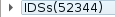

..
   Copyright holders : Commissariat à l’Energie Atomique et aux Energies Alternatives (CEA), France;
   and Laboratory for Engineering Design - LECAD, University of Ljubljana, Slovenia
   CEA and LECAD authorize the use of the METIS software under the CeCILL-C open source license https://cecill.info/licences/Licence_CeCILL-C_V1-en.html
   The terms and conditions of the CeCILL-C license are deemed to be accepted upon downloading the software and/or exercising any of the rights granted under the CeCILL-C license.

.. _loading_IDS:

Loading IDS from IMAS local data source
=======================================

This section describes and demonstrates how to load IDSs
within **IMASViz**

.. Note:: The procedure below is executed on the **GateWay HPC** and thus the
          shots in example are available on the GateWay.

Loading an IMAS IDS
-------------------

The case is named by its **URI** -- the string the Access Layer takes to open
it. The start window has a single :guilabel:`Cas` tab, and the
:guilabel:`Mode de sélection` switch at its top offers three ways of naming
that case:

- :guilabel:`Cas locaux (liste)` (the default): a flat, ordered list of the
  local cases -- the user's own imasdb and ``public`` -- in which each row, by
  default, is the URI the case will be opened with; the :guilabel:`Affichage`
  box turns each row instead into the readable fields behind it (backend,
  database, shot and run), and remembers the shape for the next session. A
  double click, or :guilabel:`Ouvrir`, opens the selected case;
  :guilabel:`Copier l'URI` copies it, so the case can be named wherever the
  Access Layer takes a URI; :guilabel:`Dossier…` turns a chosen folder of
  ``*.h5`` files into its ``path=`` URI.
- :guilabel:`Saisie libre (URI)`: a free line for a case the local walk does
  not reach -- a UDA case, a remote case, or a URI pasted from elsewhere.
  :guilabel:`Ouvrir` opens it as typed, :guilabel:`Copier l'URI` and
  :guilabel:`Dossier…` stay at hand. The list's controls --
  :guilabel:`Affichage`, :guilabel:`Trier par` and :guilabel:`Afficher` --
  are not shown in this mode, because a free URI is subject to none of them;
  choosing :guilabel:`Cas locaux (liste)` again puts the list and its
  controls back.
- :guilabel:`Legacy (5 champs)`: the historical form -- user name, IMAS database
  name, shot number, run number and backend -- filled by hand or by the
  :guilabel:`IMAS database browser`. :guilabel:`Ouvrir` builds the URI from the
  five parameters and opens it; the
  ``viz -u <user> -d <database> -s <shot> -r <run> -b <backend>`` command line
  fills this form at start-up.

An example, valid on every mode, for the GateWay HPC (where these shots are
available):

+-------------------------------+
| **IMAS IDS example**          |
+--------------------+----------+
| Parameters         | Values   |
+====================+==========+
| User name          | g2penkod |
+--------------------+----------+
| IMAS database name | viztest  |
+--------------------+----------+
| Shot number        | 52344    |
+--------------------+----------+
| Run number         | 0        |
+--------------------+----------+

In the local list this case is one row -- its URI by default, and the fields
``MDS+ · viztest · 52344 · 0`` when the :guilabel:`Affichage` box is on the
parsed shape. In the free URI line it is that same URI spelled out; in the
legacy form it is the five parameters above. The data source is the
:file:`~public/imasdb/viztest/3/0/` directory of user ``g2penkod``.

To add the databases of another user, switch to :guilabel:`Legacy (5 champs)`,
type the user name in :guilabel:`User name`, and choose *Add databases from user
…* from the :guilabel:`IMAS database browser` pop-up (a right click) -- the
available databases of that user then appear in the local list too.

Open an IDS
-----------

The procedure to open any IDS is the same. In this manual,
the procedure will be shown on a **magnetics IDS**.

1. Click :guilabel:`Open` button to open the IDS.

   A navigation tree window will open inside the
   **Multiple Document Interface (MDI)**, as shown in the figure below.

   .. image:: images/DTVFrame_empty.png
      :align: center
      :width: 550px

2. Press the **arrow button** |icon_arrowIDSroot|  on the left side of the
   **IDS root node**.

   This will expand the navigation :guilabel:`tree window` and display a
   list of all IDSs. The **filled IDSs** are market with With **blue** color,
   other IDSs are empty.
   The tree will allow browsing data for the specific shot number which is
   displayed by the root node ( ``IDSs(52344)`` ).

   .. image:: images/DTV_IDS_root_open.png
      :align: center
      :width: 550px

   When IDS or node label is selected the :guilabel:`Node documentation`
   widget displays what the opened case holds for that node: its name and its
   documentation, the status the data dictionary gives it (*required*,
   *optional*, *experimental*, *alpha*, *obsolescent*) and its units. A scalar
   shows its value; an array shows its shape and its number of values, the
   smallest and the largest of its entries that are numbers, how many entries
   are zero, and how many are not numbers (``nan``, ``inf``), followed by the
   values themselves -- at most 200 at each end of a long array, with the number
   of values left out stated. A node that holds no values of its own, such as a
   structure, shows its name and its documentation only; a node whose values
   cannot be read says so, and says why. A row the node cannot answer is simply
   absent from the widget.

   .. image:: images/DTVFrame_node_doc.png
      :align: center
      :width: 550px

   The :guilabel:`Node Documentation` widget can be freely taken out from the
   main window by clicking the :guilabel:`undock` button |button_undock|
   and positioned anywhere on the screen. The same thing goes for
   the :guilabel:`Preview Plot` and :guilabel:`Log` widget.

   .. image:: images/DTVFrame_undock_example.png
      :align: center
      :width: 550px

3. Open the **magnetics IDS** by right-clicking on the **magnetics** node
   and selecting the command :guilabel:`Get magnetics data for occurrence`
   (occurrence 0) as shown in the figure below.

   .. image:: images/DTV_open_magnetics_IDS.png
      :align: center
      :width: 400px

   The submenu lists one entry per occurrence **this case holds data for** and
   this window does not display yet; an IDS with no such occurrence left states
   it instead of offering an empty menu. Which occurrences hold data is answered
   by the opened case, so the blue colour of an IDS name and that list always
   agree.

   .. Note:: Alternative: Double-clicking on the **IDS node label** -- or
             pressing :kbd:`Return` with that node selected -- loads the lowest
             occurrence of that IDS that is not displayed yet, with the default
             view described below. When every occurrence the case holds is
             already on screen, nothing is loaded and the :guilabel:`Log`
             widget says so.

   The magnetics IDS nodes are displayed as new nodes in the tree, as shown in
   the figure below. Nodes of an IDS are organized according to the
   **IMAS data dictionary**. Inside the **magnetics** tree, plottable
   **FLT_1D** nodes are colored blue (array length > 0).

    .. image:: images/DTV_magnetics_IDS_contents_FLT_1D.png
      :align: center
      :scale: 80%
      
Adding a new view for IDSs containing a dynamic Array Of Structure
------------------------------------------------------------------

By default, Viz opens a view displaying only one time slice, even if
more time slices have been loaded in memory during IDS loading described
above. This default view ('First time slice only') ensures to reduce the time
to build the IDS tree which is displayed to the user. The node that heads the
view says what it displays, next to the occurrence number:

.. code-block:: text

   equilibrium
      occurrence 0 [displaying first time slice]

Different views of the same occurrence can be added by right-clicking on that
node -- the entry :guilabel:`Add a new view for <IDS>` is offered whenever the
loaded occurrence holds at least one dynamic Array Of Structure, whatever the
view it was first built with -- as shown in the image below.

    .. image:: images/views_menu.png
      :align: center
      :scale: 80%

The different views are:

- 'All time slices': all time slices are displayed in the tree

- 'One over 10 time slices' : only 1 slice over 10 is displayed

- 'Specific time slice only': only 1 slice is displayed with a time index choosen by the user

- 'First time slice only': this is the default view.

The index asked for by 'Specific time slice only' is limited to the slices the
occurrence already in memory holds, and the question belongs to the window that
owns the view. An IDS can hold more than one dynamic Array Of Structure (the
reference *equilibrium* holds 49 ``time_slice`` and 1 ``grids_ggd``) and one
index applies to all of them: an index past the end of the narrower one is
refused, and the :guilabel:`Log` widget names that array and how many elements
it holds.

Below an example of 2 views of the same occurrence, the view
'One over 10 time slices' has been added by the user.

    .. image:: images/two_views.png
      :align: center
      :scale: 80%

