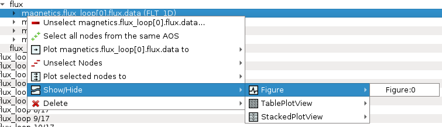
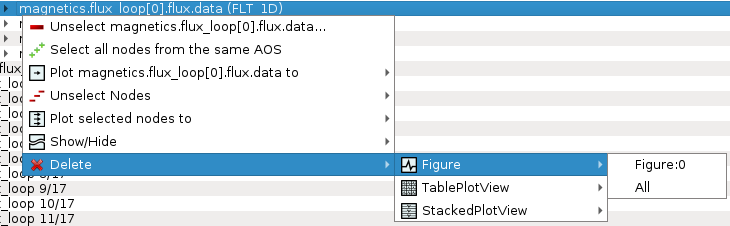
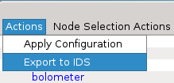
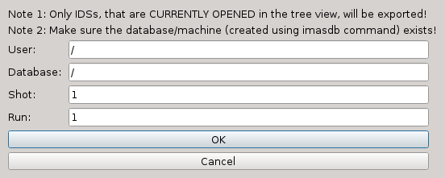
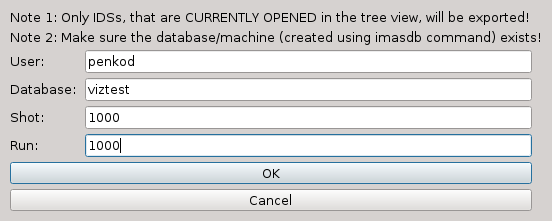
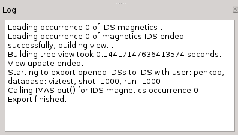
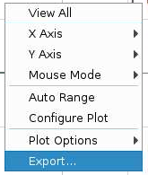
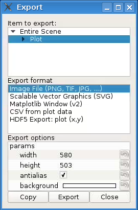
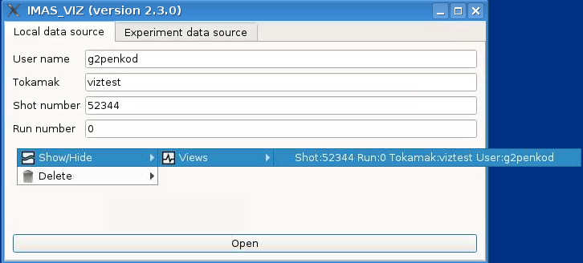

..
   Copyright holders : Commissariat à l’Energie Atomique et aux Energies Alternatives (CEA), France;
   and Laboratory for Engineering Design - LECAD, University of Ljubljana, Slovenia
   CEA and LECAD authorize the use of the METIS software under the CeCILL-C open source license https://cecill.info/licences/Licence_CeCILL-C_V1-en.html
   The terms and conditions of the CeCILL-C license are deemed to be accepted upon downloading the software and/or exercising any of the rights granted under the CeCILL-C license.

.. include:: ../icons.inc

.. _other_GUI_features:

Other GUI features
==================

Other :guilabel:`IMASViz` GUI features are listed here.

Hide/Show Plot Window
---------------------

To **hide** or **show** any of the plot windows (:guilabel:`Figure`,
:guilabel:`Table Plot View` etc.), first right-click on any
signal node. From the shown pop-up menu, select the command
:guilabel:`Show/Hide` |icon_showHide| and select the plot window you wish to
show or hide.

.. note::
   Shown plot windows will be hidden while hidden windows will be shown.

   Show/Hide plot window.

Delete Plot Window
------------------

To delete any of the plot windows, first right-click on any signal node.
From the shown pop-up menu, select the command
:guilabel:`Delete` and select the plot window you wish to delete or delete
all plot windows of certain type (:guilabel:`Figure`,
:guilabel:`Table Plot View` etc.).

.. warning::
   The plot window will be deleted permanently.

   Delete plot window.

Export IDS
----------

This feature allows the user to export the opened IDSs to a separate IDS with
custom parameters.

.. Note::
   Only IDSs that are currently opened and populated in the tree view window are
   exported using this feature.

.. Note::
   IMAS database (e.g. device or machine) must exist before trying to export IDS
   to it.

To export the IDSs, first navigate to the menu :guilabel:`Actions` ->
:guilabel:`Export to IDS`.

   :guilabel:`Export to IDS` feature in the menu bar.

A popup dialog will be shown where the IDS case parameters are set.

   Empty dialog of the :guilabel:`Export to IDS` feature.

The IDS case parameters are described below:

+--------------------+-----------------------------------------------------------+
| **GUI Fields**     | **Description**                                           |
+====================+===========================================================+
| User name          | Creator/owner of the IMAS IDSs database                   |
+--------------------+-----------------------------------------------------------+
| IMAS database name | IMAS database label, usually device/machine name of the   |
|                    | IMAS IDS database (i. e. iter, aug, west...)              |
+--------------------+-----------------------------------------------------------+
| Shot number        | Pulse shot number                                         |
+--------------------+-----------------------------------------------------------+
| Run number         | Pulse run number                                          |
+--------------------+-----------------------------------------------------------+
| Backend            | Where the pulse is written: HDF5 or MDSplus               |
+--------------------+-----------------------------------------------------------+

The four fields start from the case this tree view has open, and each is checked
as it is entered: the two number fields only take digits, and a field left empty
is answered with its own name rather than sent to the Access Layer.

When the case parameters are set, press the :guilabel:`OK` button to export to
the specified new IDS.

   :guilabel:`Export to IDS` feature dialog with set parameters.

The four fields name one case: the pulse is written under
``<database>/<data dictionary major version>/<shot>/<run>``, at the data
dictionary the exported IDSs were read with. That version comes from the data,
not from the Access Layer running the application: an IDS read at version 3.35.0
is written as a version 3 case, and an export asked for under another major
version is refused before anything is written.

The export status gets displayed in the tree view log widget: the number of IDSs
written out of the number opened, each IDS the target refused named with the
reason it was refused, and the URI that was written to.

   :guilabel:`Export to IDS` finish message.

Export plot
-----------

This feature allows the user to export:

- plot to image,
- plot to .SVG format,
- plot to matplotlib window, and
- plot data to CSV or HDF5 format.

This feature is accessible by right-clicking anywhere inside the plot window
and by selecting :guilabel:`Export...` option in the shown popup menu.

   Selections of the :guilabel:`Export` feature in the popup menu.

A dialog window will be shown, displaying the possible export options.
Some the export options allow also setting basic parameters such as image
size etc.

   :guilabel:`Export` feature dialog window.

Hide/Show/Delete DTV
--------------------

This feature allows the user to either hide, show or delete existing
**Data Tree Views** (DTVs).

This feature is available from the starting dialog window (the one where the
database parameters **user**/**database**/**shot**/**run** are being set) by
right clicking anywhere inside the window. A popup menu will be shown displaying
those available options.

   :guilabel:`Show/Hide/Delete DTV` popup menu.

Save/Load Session
-----------------

A **session** is what is on the screen when :guilabel:`IMASViz` is closed: the
case views that are open, the IDS occurrences they have loaded, the quantities
that are selected, and the plot windows that were drawn. The two commands
:guilabel:`Actions` -> :guilabel:`Save session` and :guilabel:`Actions` ->
:guilabel:`Load session` write that down and put it back.

To save a session, select :guilabel:`Save session` and type a name in the dialog.
The session is written to :file:`$HOME/.imasviz/<name>.vsess`, beside the plot and
selection configuration files.

To put a session back, select :guilabel:`Load session` and choose one of the
sessions that folder holds -- the sub-menu is only on the menu once at least one
session has been saved. Nothing else is asked: the file names the cases, so a
session comes back without retyping the database parameters.

+-------------------------------------+-----------------------------------------+
| **What the file keeps**             | **How it comes back**                   |
+=====================================+=========================================+
| The cases (their URIs)              | Each one is opened as the *Open* entry  |
|                                     | opens it, and shown as a case view      |
+-------------------------------------+-----------------------------------------+
| The IDS occurrences that were       | Each one is loaded again, with the same |
| loaded and the time slices each     | time-slice choice: *all*, *one over 10*,|
| was asked for                       | *first*, or the index that was asked    |
+-------------------------------------+-----------------------------------------+
| Which branches of the tree were     | The IDS branch and the occurrence       |
| unfolded                            | branch are unfolded again; deeper       |
|                                     | branches stay as the load leaves them   |
+-------------------------------------+-----------------------------------------+
| The selected quantities, in the     | Selected on the case view, as a node    |
| order they were picked              | selection file is applied               |
+-------------------------------------+-----------------------------------------+
| The plot windows: kind, quantities, | Each window is drawn again by the same  |
| axis, table cells, and the **key**  | command that drew it the first time,    |
| of each                             | under the key it had -- see below       |
+-------------------------------------+-----------------------------------------+

The key of a window is not a label: it is the name the :guilabel:`Show/Hide` and
:guilabel:`Delete` menus address it by, and the name the *Plot X to -> Figure*
menu offers when a quantity is added to a window that is already open. A saved
session keeps it, so a window that was :guilabel:`SlicesPlot1` comes back as
:guilabel:`SlicesPlot1`, and the menus still name one line for it.

.. note::
   A restored window is drawn from the data again, not taken out of the file. So
   it owns its time sliders, its axis, its legend and its log, and it answers the
   same gestures as a window drawn by hand. A Stacked Plot View is filled from the
   selection, so the selection of its case is set to its quantities while it is
   drawn, and the selection the session was left on is applied afterwards.

.. note::
   Reading a session is fast because its IDSs are read lazily: only the structure
   each tree needs is walked, and the values are taken from the file when a
   quantity is drawn. Measured on the reference case (WEST 54924 run 0): the tree
   of one ``equilibrium`` occurrence costs 0,10 s this way, against 3,99 s when
   the same IDS is read whole -- and the tree is the same either way.

.. warning::
   A session names quantities of a **data dictionary**. A case that comes back at
   another version than the one the session was written with can hold fewer nodes
   than the file names: the difference is said in the log when the case is opened,
   and each quantity that is gone is named when its window is drawn. A case that
   cannot be opened at all costs its own windows and nothing else, so the other
   cases of the file still come back.

.. warning::
   What a session does not keep yet: the styling of a window (title, axis labels,
   margins, error bars), the position and size of a window in the area, and the
   windows drawn by a plugin (:guilabel:`Profiles`, :guilabel:`Equilibrium
   overview`) -- those are drawn from a question the plugin asks, so they are left
   out and the log says which windows were skipped.

