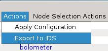
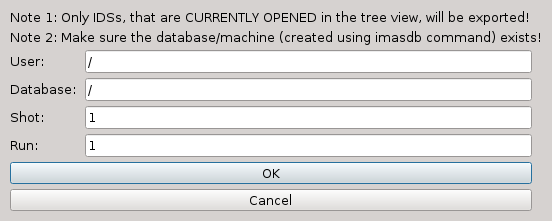
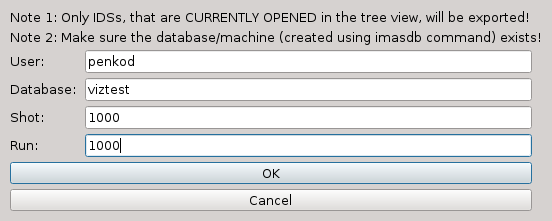
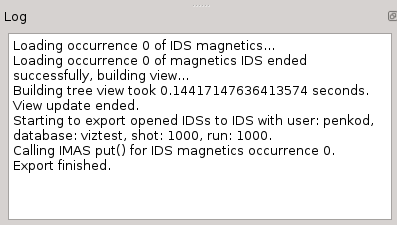
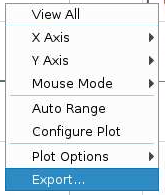
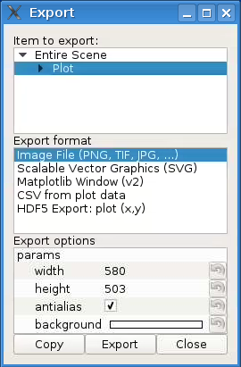

..
   Copyright holders : Commissariat à l’Energie Atomique et aux Energies Alternatives (CEA), France;
   and Laboratory for Engineering Design - LECAD, University of Ljubljana, Slovenia
   CEA and LECAD authorize the use of the METIS software under the CeCILL-C open source license https://cecill.info/licences/Licence_CeCILL-C_V1-en.html
   The terms and conditions of the CeCILL-C license are deemed to be accepted upon downloading the software and/or exercising any of the rights granted under the CeCILL-C license.

.. include:: ../icons.inc

.. _other_GUI_features:

Other GUI features
==================

Other :guilabel:`IMASViz` GUI features are listed here.

The Windows menu
----------------

Every window the run holds is listed once, under :guilabel:`Windows`. That entry
is on the menu bar of the application window -- the bar along the top of
:guilabel:`IMASViz`, on screen whatever you are looking at -- and on the menu bar
of every case view, where the same list is closer to the work.

The entry is always open. A disabled menu in a bar cannot be clicked, and the
list it would show is this run's, which changes as cases come and go -- so the
entry stays active and is redrawn each time it is opened. With nothing open it
offers one disabled line, :guilabel:`No open window`; as soon as a window
exists, including one that opened after the menu was first drawn, its line
replaces that.

The windows are grouped **by case first**. Each case opens a sub-menu holding its
view and the plot windows that case drew. A plot window that drew its curves from
more than one case sits in **each** of those sub-menus (a comparison). A window a
plugin drew belongs to the case whose shot view offered its entry -- the
:guilabel:`Profiles` panel and the :guilabel:`Equilibrium` chart both serve that
one case -- so it sits in that case's sub-menu like the rest of its windows, and
:guilabel:`Close this case` reaches it. That is what the menu is for when several
cases are open: a window can be found by the case it came from, and the whole
case can be gathered or dismissed in one gesture.

Within a case's sub-menu:

.. list-table::
   :header-rows: 0

   * - the name of a window
     - one line per window the case owns -- its view, and each plot window by the
       name its title carries: the name of the window and the case name, both,
       separated, when its curves came from more than one case. Hover the
       line (or the title bar) and the whole URI is what is read, one per line:
       the title bar carries the short name because it is the one guaranteed to
       fit, and the URI is the answer to the question behind it. A line is
       **checked** while its window is on the screen, and clicking it hides a
       shown window or shows a hidden one.
   * - :guilabel:`Show only this case`
     - show this case and its windows, and hide the other cases' windows. A
       window drawn from this case and another stays shown: isolating a case is
       about the other cases, not the windows this case still reads.
   * - :guilabel:`Close this case`
     - close this case's windows for good. A window drawn from this case and
       another is **hidden, not closed** -- its other case still reads a live
       curve out of it, so the key is kept and that case brings it back.

At the top level:

.. list-table::
   :header-rows: 0

   * - :guilabel:`Show all` / :guilabel:`Hide all`
     - the same for every window at once.
   * - :guilabel:`Hide others` / :guilabel:`Close others`
     - every window **except the one you are in** (the one on top, or the one on
       the tab that has focus). :guilabel:`Close others` closes for good;
       :guilabel:`Hide others` only gets them off the screen.
   * - :guilabel:`Disposition`
     - how the :ref:`MDI area <layout_modes>` lays the windows out --
       :guilabel:`Windows`, :guilabel:`Tabs`, :guilabel:`Tiled`,
       :guilabel:`Cascaded`. On the application bar only.
   * - :guilabel:`Delete`
     - one line per window, again grouped by kind, and one :guilabel:`All` per
       group.
   * - :guilabel:`Next window` / :guilabel:`Previous window`
     - on the application bar only, with :kbd:`Ctrl+Tab` and
       :kbd:`Ctrl+Shift+Tab`.

The check mark reports the screen, not the menu: a window taken off the screen by
its own close box, or by a gesture that never went through the menu, shows the
same unchecked line.

.. note::
   Hiding a window is not closing it. It keeps the data it read from the case, it
   keeps the key its title shows, and a saved session writes it hidden and puts it
   back hidden.

.. warning::
   :guilabel:`Delete` takes a window out of the run for good. On a case view it
   closes the case: the IDSs that were loaded for it go with the last view that
   was showing it, so drawing one of its quantities again means reading the case
   again.

.. note::
   The menu lists only windows that still exist. The one exception is a window
   whose object was lost from under a live registration -- an interrupted close
   can leave it -- in which case the first thing to ask what is open, the menu
   as well as any of its gestures and a saved session, releases that
   registration and says in the log panel which window it was, its key and the
   case it served. Afterwards the group that held nothing but that window is
   gone from the menu, and the number of the next window of that kind is
   available again. Nothing you need to do: repeated :guilabel:`Close this
   case` on that case is a no-op that changes nothing else.

.. _layout_modes:

Laying the windows out
----------------------

A pile of titled windows is the state a case opens into, and it is the state
the MDI area is in until you ask for another. The :guilabel:`Disposition`
sub-menu lays **every** window in the area out in one of four ways:

.. list-table::
   :header-rows: 0

   * - :guilabel:`Windows` (the default)
     - the titled pile: windows floating over one another, rearranged by hand.
   * - :guilabel:`Tabs`
     - every window as one tab in a single strip. The big declutter when several
       cases are open: a strip, not a pile.
   * - :guilabel:`Tiled`
     - the windows split into a grid, all of them visible at once.
   * - :guilabel:`Cascaded`
     - the windows stacked diagonally, every title bar reachable.

The choice is written to the preferences file as :code:`Mdi_view_mode` (see
:ref:`user_preferences`), so a case opened in the next run is laid out the way
you last left it. It is refused, by name in the log, when the value is not one
of the four, as every other preference line is.

Closing a window with its own box
---------------------------------

The box in the corner of a window's title bar **hides** the window: it leaves the
screen, stays on the :guilabel:`Windows` menu -- unchecked -- and clicking that
line puts it back where it was, with the curves it had already read. A plot
window costs a read of the case to redraw, and the box is what most users reach
for when they want a window out of the way rather than one thrown away.

To make the box close the window for good instead, add this line to
:file:`~/.imasviz/preferences` (see :ref:`user_preferences`)::

    Close_button_deletes=1

It then does what :guilabel:`Delete` does: the window leaves the menu, the
session, and the case data it was holding.

The three families of window -- a case view, a plot window, and the window a
plugin draws -- follow that one rule. A plugin that draws a window of its own
outside the MDI area has to say so: see
:ref:`plugin_answers_and_sessions`.

Export IDS
----------

This feature allows the user to export the opened IDSs to a separate IDS with
custom parameters.

.. Note::
   Only IDSs that are currently opened and populated in the tree view window are
   exported using this feature.

.. Note::
   IMAS database (e.g. device or machine) must exist before trying to export IDS
   to it.

To export the IDSs, first navigate to the menu :guilabel:`Actions` ->
:guilabel:`Export to IDS`.



   :guilabel:`Export to IDS` feature in the menu bar.

A popup dialog will be shown where the IDS case parameters are set.



   Empty dialog of the :guilabel:`Export to IDS` feature.

The IDS case parameters are described below:

+--------------------+-----------------------------------------------------------+
| **GUI Fields**     | **Description**                                           |
+====================+===========================================================+
| User name          | Creator/owner of the IMAS IDSs database                   |
+--------------------+-----------------------------------------------------------+
| IMAS database name | IMAS database label, usually device/machine name of the   |
|                    | IMAS IDS database (i. e. iter, aug, west...)              |
+--------------------+-----------------------------------------------------------+
| Shot number        | Pulse shot number                                         |
+--------------------+-----------------------------------------------------------+
| Run number         | Pulse run number                                          |
+--------------------+-----------------------------------------------------------+
| Backend            | Where the pulse is written: HDF5 or MDSplus               |
+--------------------+-----------------------------------------------------------+

The four fields start from the case this tree view has open, and each is checked
as it is entered: the two number fields only take digits, and a field left empty
is answered with its own name rather than sent to the Access Layer.

When the case parameters are set, press the :guilabel:`OK` button to export to
the specified new IDS.



   :guilabel:`Export to IDS` feature dialog with set parameters.

The four fields name one case: the pulse is written under
``<database>/<data dictionary major version>/<shot>/<run>``, at the data
dictionary the exported IDSs were read with. That version comes from the data,
not from the Access Layer running the application: an IDS read at version 3.35.0
is written as a version 3 case, and an export asked for under another major
version is refused before anything is written.

The export status gets displayed in the tree view log widget: the number of IDSs
written out of the number opened, each IDS the target refused named with the
reason it was refused, and the URI that was written to.



   :guilabel:`Export to IDS` finish message.

Export plot
-----------

This feature allows the user to export:

- plot to image,
- plot to .SVG format,
- plot to matplotlib window, and
- plot data to CSV or HDF5 format.

This feature is accessible by right-clicking anywhere inside the plot window
and by selecting :guilabel:`Export...` option in the shown popup menu.



   Selections of the :guilabel:`Export` feature in the popup menu.

A dialog window will be shown, displaying the possible export options.
Some the export options allow also setting basic parameters such as image
size etc.



   :guilabel:`Export` feature dialog window.

Hide/Show/Delete DTV
--------------------

A **Data Tree View** (DTV) -- the case view a shot and a run were opened into --
is a window like any other, so it is on the :ref:`Windows menu
<other_GUI_features>` beside the plot windows: its line is the case it shows,
clicking it hides the view or brings it back, and :guilabel:`Delete` closes the
case for good.

It used to be elsewhere, and only there: those three commands were on the
right-click pop-up of the starting dialog (the one where the database parameters
**user**/**database**/**shot**/**run** are set), which was the only place in the
application able to bring a hidden case view back -- on a panel that looks like a
form, and nowhere you would right-click looking for a menu. The pop-up now offers
the databases and nothing else.

.. note::
   Hiding a case view takes the menu bar it owns off the screen with it, which is
   why the list of windows is also on the application bar: a hidden view cannot
   hide the gesture that brings it back.

.. _save_load_session:

Save/Load Session
-----------------

A **session** is what is on the screen when :guilabel:`IMASViz` is closed: the
case views that are open, the IDS occurrences they have loaded, the quantities
that are selected, the plot windows that were drawn, and what had been set on
each of those windows. The two commands :menuselection:`File --> Save session`
and :menuselection:`File --> Load session` write that down and put it back.

.. note::
   Those lines are on the **File** menu of the application window, the bar
   along the top of :guilabel:`IMASViz` -- not on a case view's
   :guilabel:`Actions` menu. A session is the whole screen, every case view and
   every figure together, so the gesture belongs to the window that holds them
   and is on screen whatever you are looking at. That bar also holds
   :menuselection:`File --> Quit` (:kbd:`Ctrl+Q`), which closes the application
   the way the window's own button does -- asking first, and keeping the session
   if you asked for that (:ref:`below <last_session>`).

To save a session, select :guilabel:`Save session` and type a name in the dialog.
The session is written to :file:`$HOME/.imasviz/<name>.vsess`, beside the plot and
selection configuration files.

To put a session back, select :guilabel:`Load session` and choose one of the
sessions that folder holds -- the sub-menu is only on the menu once at least one
session has been saved, and the list is drawn again every time the menu opens, so
a session saved a minute ago is there without restarting. Nothing else is asked:
the file names the cases, so a session comes back without retyping the database
parameters.

To start over, select :menuselection:`File --> New session`. It asks one
question first -- whether the session that is on the screen should be saved --
and clears the screen only afterwards. A *Yes* writes the session under the name
the dialog gives it -- the same dialog as :guilabel:`Save session` -- and then
clears it; a *No* clears it and keeps nothing. The clearing is the same gesture
as the :guilabel:`Delete` lines of the :ref:`Windows menu
<other_GUI_features>`: every case view goes, and with it every figure, and every
window a plugin drew inside a case view -- so what is left is the start window
alone, and the next case you open opens as the first window of the run, with the
numbers of the figures back at 1.

.. note::
   The question is the only thing the gesture spends. A name you do not give,
   or a session that cannot be written, keeps the whole screen as it was --
   because what you were promised was a save *and* a clear, and half of it did
   not happen -- and the reason is where you read it, on the log panel. And a
   screen that holds no window answers with no question at all: it is already a
   new session, and there is nothing to save or to clear. What the gesture keeps
   is exactly what it saved, under exactly the name you gave.

+-------------------------------------+-----------------------------------------+
| **What the file keeps**             | **How it comes back**                   |
+=====================================+=========================================+
| The cases (their URIs)              | Each one is opened as the *Open* entry  |
|                                     | opens it, and shown as a case view      |
+-------------------------------------+-----------------------------------------+
| The IDS occurrences that were       | Each one is loaded again, with the same |
| loaded and the time slices each     | time-slice choice: *all*, *one over 10*,|
| was asked for                       | *first*, or the index that was asked    |
+-------------------------------------+-----------------------------------------+
| Which branches of the tree were     | The IDS branch and the occurrence       |
| unfolded                            | branch are unfolded again; deeper       |
|                                     | branches stay as the load leaves them   |
+-------------------------------------+-----------------------------------------+
| The selected quantities, in the     | Selected on the case view, as a node    |
| order they were picked              | selection file is applied               |
+-------------------------------------+-----------------------------------------+
| The plot windows: kind, quantities, | Each window is drawn again by the same  |
| axis, table cells, and the **key**  | command that drew it the first time,    |
| of each                             | under the key it had -- see below       |
+-------------------------------------+-----------------------------------------+
| What had been set on each window:   | Put back after the window is drawn, in  |
| where its time sliders stood, which | that order: the sliders (which reload   |
| of the **error lines** were on and  | the curves they stand on), then the     |
| at what step, the range a           | lines at the step they were at, then    |
| :guilabel:`Plot Figure` was zoomed  | the range, then the place. A window of  |
| onto, whether the window was        | the area is moved, maximized or hidden  |
| maximized or hidden, and where it   | as it was left: hidden is not closed,   |
| sat                                 | and its key stays in the menus          |
+-------------------------------------+-----------------------------------------+
| A window a plugin drew: which       | Its menu line is asked again of that    |
| plugin, which entry of it, on which | case view, with the occurrence it was   |
| IDS of which case, and the answers  | given and the key it had handed over,   |
| that entry was given                | so nothing is asked of the user again   |
+-------------------------------------+-----------------------------------------+

The key of a window is not a label: it is the name a saved session carries, and
the name the *Plot X to -> Figure* menu offers when a quantity is added to a
window that is already open. What the title bar and the :guilabel:`Windows`
menu show is the name the user asks for, and the case the window serves:
a window whose key is :guilabel:`SlicesPlot1` is what those list as
:guilabel:`Plot 1 — west-54924.0`. A saved session keeps the key, so the
window that was :guilabel:`Plot 1 — west-54924.0` comes back under the very
same title, and the menus still name one line for it.

.. note::
   A restored window is drawn from the data again, not taken out of the file. So
   it owns its time sliders, its axis, its legend and its log, and it answers the
   same gestures as a window drawn by hand. A Stacked Plot View is filled from the
   selection, so the selection of its case is set to its quantities while it is
   drawn, and the selection the session was left on is applied afterwards.

.. note::
   Reading a session is fast because its IDSs are read lazily: only the structure
   each tree needs is walked, and the values are taken from the file when a
   quantity is drawn. Measured on the reference case (WEST 54924 run 0): the tree
   of one ``equilibrium`` occurrence costs 0,10 s this way, against 3,99 s when
   the same IDS is read whole -- and the tree is the same either way.

.. warning::
   A session names quantities of a **data dictionary**. A case that comes back at
   another version than the one the session was written with can hold fewer nodes
   than the file names: the difference is said in the log when the case is opened,
   and each quantity that is gone is named when its window is drawn. A case that
   cannot be opened at all costs its own windows and nothing else, so the other
   cases of the file still come back.

.. warning::
   What a session does not keep: the state that belongs to a **panel** rather than
   to a window -- the time sliders of a :guilabel:`Table Plot View` or a
   :guilabel:`Stacked Plot View` are per panel, and the zoom of an
   :guilabel:`Image` figure is per picture. Those windows come back as the drawing
   leaves them.

   What a hand styled **is** kept, and only that. The pen of a trace (colour, line
   style and thickness, symbol, symbol size and the two symbol colours) and the
   text of a title or an axis label are written under the quantity that drew them,
   for the traces the hand actually touched -- which is why the colour a figure
   chose for itself is chosen again the next time the case is drawn, and two traces
   of a new figure stay legible side by side. A style whose quantity the reopened
   case no longer draws is named in the log of the case and costs its own style and
   nothing else.

   The colours of an :guilabel:`Image` figure are kept the same way, and for the
   same reason: one **map** and one **level range** for the window -- never one per
   picture, since the pictures of a window share a scale -- written only for the
   half a hand actually moved. A window nobody dressed writes neither, so it opens
   with the map this installation holds and the span its own pictures settle on,
   rather than the colours and the numbers of the case the file was saved from. A
   map this installation cannot draw -- a name written on another node, where the
   library's own menu reaches the maps of matplotlib -- is named in the log of the
   case, and the window keeps the colours it opens with while **the level range of
   the file still stands**: losing the number because the colour is missing would
   hide the half that still means something. See :ref:`2d_colour_scale`.

.. warning::
   A plugin window comes back **as its entry draws it**, not as the user left it.
   The file keeps the gesture -- which entry, on which IDS, at which occurrence --
   and replays it, so the :guilabel:`Profiles` panel returns with the tabs of the
   occurrence the **file** names, which need not be the first one the menu would
   have chosen, and with its time cursors at the index the entry starts on: what
   was set inside that window -- a page moved on, a cursor dragged, a tab added by
   a plugin of your own -- is gone. What the entry itself refuses is named in the
   log of the case: an
   occurrence the plugin does not read (the :guilabel:`Equilibrium overview` reads
   occurrence 0 of :guilabel:`equilibrium` and :guilabel:`wall`, and says so rather
   than drawing curves from an occurrence the file did not name), a plugin that
   offers no such entry on that node, or an entry whose code cannot be handed the
   answers -- which leaves that one window out and puts the rest of the screen
   back.

.. _last_session:

The session of the run that ended
`````````````````````````````````

**This is a preference, and it is off by default.** Nothing is written when you
close :guilabel:`IMASViz`, and the next start asks you nothing. To have the session
of a run kept without asking for it every time, set the option in
:file:`$HOME/.imasviz/preferences` -- see :ref:`user_preferences`:

  Auto_save_session=1

With it on, closing writes the session that was on screen to
:file:`$HOME/.imasviz/last_session.vsess`, under one name nobody chose, and the
next start asks once:

   Restore the session IMASViz was closed with?

Answering no opens nothing and leaves the file where :guilabel:`Load session`
lists it; answering yes puts that session back. The question is only asked when
such a file is there, so the first run -- and every run that followed one closed
with nothing open -- asks nothing. The option answers **both** ends of it at once:
with it off there is no write and no question, even when a file an earlier release
left behind is still in the folder.

The file is a session like the ones you name yourself, so it can be opened by hand
from :menuselection:`File --> Load session`, copied, or read over: it is a file,
not a hidden state. And with the preference off, saving by hand changes nothing
about it -- a session you name is always available, kept or not.

The look of the application
---------------------------

The chrome of the application -- the menu bar and the menus, the tree and its
selection, the docks, the log panel, the input fields, the title of a window and
the canvas all the windows float on -- is dressed with one of two themes,
``light`` (the default) or ``dark``. It is a line in the preferences file, read at
start-up; see :ref:`user_preferences`.

What a theme does not dress is the inside of a plot: a figure keeps its black
ground either way. The trace colours, the colour maps and the slice lines were all
picked against that black, on either theme.

A theme changes colours and nothing else. The size of the controls is the same in
both, and it is set for a hand holding a stylus on a tablet rather than a mouse
pointer: the band along the edge and the corner of a window that resizes it, the
arrows that open and close a branch of the data tree, the scroll bars, the
separators between panels, the height of a row of the tree. Two of those controls
were lost for a while behind a thinner chrome -- a window could no longer be
grabbed at its corner, and the tree showed no arrows -- so what holds them now is
what each of them answers on screen, not how it looks: a 12 pixel band, a 20
pixel scroll bar, a 14 pixel separator, a tree row 26 pixels tall, and a 28 pixel
indentation column, which is the ground the gesture that opens a node has to
land on.

The title bar of a window is drawn by the widget style itself and only tinted by
the theme. That is deliberate: the bar carries the buttons that minimise,
maximise and close the window, and a rule that paints the bar takes those buttons
with it.


