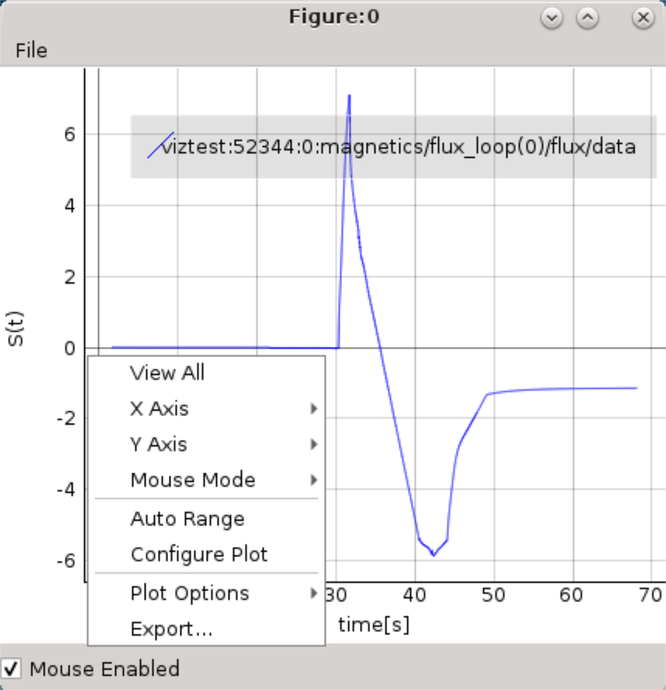
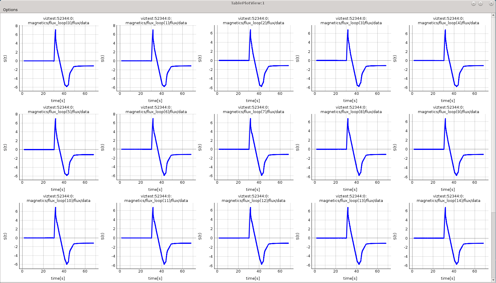
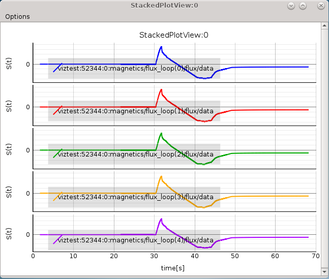

..
   Copyright holders : Commissariat à l’Energie Atomique et aux Energies Alternatives (CEA), France;
   and Laboratory for Engineering Design - LECAD, University of Ljubljana, Slovenia
   CEA and LECAD authorize the use of the METIS software under the CeCILL-C open source license https://cecill.info/licences/Licence_CeCILL-C_V1-en.html
   The terms and conditions of the CeCILL-C license are deemed to be accepted upon downloading the software and/or exercising any of the rights granted under the CeCILL-C license.

.. include:: ../icons.inc

.. _plotting_1d_arrays:

Plotting 1D arrays
==================

Plotting 1D arrays and plot handling are the main features and
purposes of the :guilabel:`IMASViz`.

This section describes the basics of plotting a 1D array stored in
an IDS and how to handle the existing plots.

.. _plotting_single_1d_array:

Plotting a single 1D array to a figure
-----------------------------------------

The procedure to plot 1D array is as follows:

1. Navigate through the **magnetics IDS** and search for the node containing
   **FLT_1D** data, for example **magnetics.flux_loop[0].flux.data**.
   Plottable FLT_1D nodes are colored **blue** (array length > 0).

   .. figure:: images/DTV_magnetics_IDS_contents_FLT_1D.png
     :align: center
     :scale: 80%
     :alt: FLT_1D plot

     Example of plottable FLT_1D node.

   By clicking on the node, the preview plot will be displayed in the
   :guilabel:`Preview Plot`, located in the main window. This
   feature helps to quickly check how the data, stored in the FLT_1D, looks
   when plotted on other figures.

   .. figure:: images/DTV_preview_plot.png
     :align: center
     :width: 550px
     :alt:   Preview Plot

     Preview Plot

2. Right-click on the **magnetics.flux_loop[0].flux.data (FLT_1D)** node.

3. From the pop-up menu, select the command
   :guilabel:`Plot ids.magnetics.flux_loop[0].flux.data to` |icon_plotSingle| ->
   :guilabel:`figure` |icon_Figure| -> :guilabel:`New` |icon_new|.

   .. figure:: images/DTV_popupmenu_plotting_single_plot.png
     :align: center
     :scale: 80%

     Navigating through right-click menu to plot data on a figure.

   The plot should display in a figure as shown in the image below.

   .. figure:: images/plotWidget_basic.png
     :align: center
     :width: 550px

     Basic plot figure display.

Basic plot display features
~~~~~~~~~~~~~~~~~~~~~~~~~~~

The features described below are available for any :guilabel:`plot display`. Most of them
are available in the right-click menu.

.. Note::
   Term :guilabel:`Plot Display` is used for any base subwindow for displaying
   plots. Following that the :guilabel:`Plot Figure` contains a single
   :guilabel:`Plot Display`, while :guilabel:`Table Plot View`
   and :guilabel:`Stacked Plot View` consist of multiple
   :guilabel:`Plot Displays`.

  Window right-click menu of a plot.

.. Disable/Enable Mouse
.. ^^^^^^^^^^^^^^^^^^^^

.. Allows enabling or disabling mouse.
.. This feature can ticked on/off on bottom left corner

View All
^^^^^^^^

Zoom to view whole plot area.

   .. figure:: images/plotDisplay_popupmenu_viewAll.png
     :align: center
     :scale: 75%

     :guilabel:`View All` feature in the right-click menu.

Auto Range
^^^^^^^^^^

Similar to :guilabel:`View All` feature with the difference that it shows
plot area between values ``X_min`` -> ``X_max`` and ``Y_min`` -> ``Y_max``,
without additional "plot margins" on the sides.

   .. figure:: images/plotDisplay_popupmenu_autoRange.png
     :align: center
     :scale: 75%

     :guilabel:`Auto Range` feature in the right-click menu.

Left Mouse Button Mode Change
^^^^^^^^^^^^^^^^^^^^^^^^^^^^^

Change between :guilabel:`Pan Mode` (move plot around) and
:guilabel:`Area Zoom Mode` (choose selectable area to zoom into).

   .. figure:: images/plotDisplay_popupmenu_mouseMode.png
     :align: center
     :scale: 75%

     :guilabel:`Mouse Mode` feature in the right-click menu.

   .. figure:: images/plotDisplay_area_zoom.png
     :align: center
     :width: 300px

     :guilabel:`Area Zoom` example: Marking zoom area using.

   .. figure:: images/plotDisplay_area_zoom_result.png
     :align: center
     :width: 300px

     :guilabel:`Area Zoom` example: Result.

Axis options
^^^^^^^^^^^^

X and Y axis range, inverse, mouse enable/disable options and more.

   .. figure:: images/plotDisplay_popupmenu_axisOptions.png
     :align: center
     :scale: 75%

     :guilabel:`Axis Options` feature in the right-click menu.

Plot Configuration and Customization
^^^^^^^^^^^^^^^^^^^^^^^^^^^^^^^^^^^^

Setting color and line properties of plots shown in the Plot Display.

   .. figure:: images/plotDisplay_popupmenu_configurePlot.png
     :align: center
     :scale: 75%

     :guilabel:`Configure Plot` feature in the right-click menu.

Each plot can be customized. By selecting this feature a separate GUI window
will open, listing all plots within the plot display window and their
properties that can be customized.

   .. figure:: images/plotDisplay_configurePlot_window.png
     :align: center

     :guilabel:`Configure Plot` GUI.

   .. figure:: images/plot_configuration_example.png
     :align: center

     Plot configuration example for single plot.

Plot options
^^^^^^^^^^^^

Enable/Disable grid, log scale and more.

   .. figure:: images/plotDisplay_popupmenu_plotOptions.png
     :align: center
     :scale: 75%

     :guilabel:`Plot Options` feature in the right-click menu.

Export feature
^^^^^^^^^^^^^^

The :guilabel:`Plot Display` scene can be exported to:
   - image file (PNG, JPG, ...). A total of **16** image formats are supported.
   - scalable vector graphics (SVG) file
   - matplotlib window
   - CSV file
   - HDF5 file

   .. figure:: images/plotDisplay_popupmenu_export.png
     :align: center
     :scale: 75%

     :guilabel:`Export` feature in the right-click menu.

   .. figure:: images/plotDisplay_export_window.png
     :align: center
     :scale: 75%

     Export GUI window.

   .. figure:: images/plotDisplay_export_matplotlib.png
     :align: center
     :width: 550px

     Comparison of IMASViz :guilabel:`Plot Figure` and
     :guilabel:`matplotlib window`

.. _add_plot_to_existing_figure:

Adding a plot to existing figure
--------------------------------

The procedure of adding a plot to an already existing figure is as follows:

1. From the previous navigation tree, navigate to the wanted node, for example
   **ids.magnetics.flux_loop[16].flux.data**

2. Right-click on the node.

3. From the pop-up menu, navigate and select
   :guilabel:`Plot <node name> to` |icon_plotSingle| ->
   :guilabel:`Figure` |icon_Figure| -> :guilabel:`SlicesPlot1`

   .. figure:: images/DTV_popupmenu_plot_to_existing_figure.png
     :align: center
     :scale: 75%

     Plotting to existing figure.

The plot will be added to the selected existing plot as shown in the image
below.

   .. figure:: images/DTV_popupmenu_plot_to_existing_figure_result.png
     :align: center
     :width: 550px

     Plotting to existing figure - result.

Comparing plots between two IDS databases
-----------------------------------------

:guilabel:`IMASViz` allows comparing of FLT_1D arrays between two different
IDS URIs. The procedure is very similar to the one
presented in the section :ref:`add_plot_to_existing_figure`:

1. Open another IMAS database, same as shown in section :ref:`loading_IDS`.
   In this manual this will be demonstrated using IDS with :guilabel:`shot`
   **52682** and :guilabel:`run` **0** parameters.

   +-------------------------+-----+
   | **Manual IDS case**           |
   +--------------------+----------+
   | parameters         | values   |
   +--------------------+----------+
   | User name          | g2penkod |
   +--------------------+----------+
   | IMAS database name | viztest  |
   +--------------------+----------+
   | Shot number        | 52682    |
   +--------------------+----------+
   | Run number         | 0        |
   +--------------------+----------+

2. Load **occurrence 0** of **magnetics** IDS

3. Navigate through the IDS search for the wanted node, for example
   **ids.magnetics.flux_loop[0].flux.data**.

4. Right-click on the node.

5. From the pop-up menu, navigate and select
   :guilabel:`Plot <node name> to` |icon_plotSingle| ->
   :guilabel:`Figure` |icon_Figure| -> :guilabel:`SlicesPlot1`

The plot will be added to the existing plot as shown in the image below.

   .. figure:: images/DTV2_popupmenu_plot_to_existing_figure_result.png
     :align: center
     :width: 550px

     Plotting from other IDS to existing figure - result.

.. _plotting_a_selection_to_figure:

Plotting a selection of 1D arrays to figure
-------------------------------------------

The procedure of 1D arrays selection and plotting to a figure is as
follows:

1. In main tree view window set a selection of nodes holding 1D arrays.

   .. note::
      How to create a selection of arrays is described in section
      :ref:`signal_node_selection`.

2. When finished with node selection, either:
   - right-click on any FLT_1D node, or
   - click :guilabel:`Node Selection` menu on menubar of the main tree view
   window.

3. From the pop-up menu, navigate and select
   :guilabel:`Plot selected nodes to` |icon_plotMultiple| ->
   :guilabel:`Figure` |icon_Figure| -> :guilabel:`New` |icon_new|->
   :guilabel:`This IMAS database` |icon_thisDTV|.

   .. Note::
      The same procedure applies plotting the selection to an existing figure.

   .. figure:: images/DTV_popupmenu_plot_selected_nodes_to_figure_thisDTV.png
     :align: center
     :scale: 75%

     Plotting selection to a new figure using selection from the currently
     opened IDS database.

   .. figure:: images/DTV_plot_selected_nodes_to_figure_thisDTV_result.png
     :align: center
     :width: 550px

     Example of plot figure, created by plotting data from node selection.

Plotting 1D array as a function of coordinate1 along the time axis
------------------------------------------------------------------

One of the IMASViz features is to plot data along coordinate1 specified 
in the IMAS Data Dictionary. Coordinate1 data can be set
using a time slider along the time axis.
This is allowed for IDS nodes, located within **time_slice[:]** structure, and
it is already set as a default plotting feature for such arrays.

The procedure to plot such 1D array is quite identical as in section
:ref:`plotting_single_1d_array`. The procedure is described and demonstrated
on **equilibrium.time_slice[0].profiles_1d.phi** (Torodial Flux) array.

1. Navigate through the **equilibrium IDS** and search for the time slice node
   containing
   **FLT_1D** data, for example **equilibrium.time_slice[0].profiles_1d.phi**.

   .. figure:: images/DTV_plot_as_a_function_of_coordinate1.png
     :align: center
     :scale: 80%

     Example of plottable FLT_1D time slice node.

2. Right-click on the **equilibrium.time_slice[0].profiles_1d.phi (FLT_1D)**
   node.

3. From the pop-up menu, select the command
   :guilabel:`Plot equilibrium.time_slice[0].profiles_1d.phi to`
   |icon_plotSingle| -> :guilabel:`figure` |icon_Figure| ->
   :guilabel:`New` |icon_new|.

   .. figure:: images/DTV_popupmenu_plotting_as_a_function_of_coordinate1.png
     :align: center
     :scale: 80%

     Navigating through right-click menu to plot data to plot figure.

   The plot should display in plot figure as shown in the image below.
   Note that **coordinate1 = ids.equilibrium.time_slice[0].profiles_1d.psi**
   for this FLT_1D data array.

   .. figure:: images/plotWidget_function_of_coordinate1.png
     :align: center
     :width: 550px

     Time slice plot figure display. The data are represented as a function of
     coordinate1 (**ids.equilibrium.time_slice[0].profiles_1d.psi**) for the
     first **phi** time slice
     (**ids.equilibrium.time_slice[0].profiles_1d.phi**).

   The time slider allows you to move along the time axis and the plot will
   change accordingly.

   .. figure:: images/plotWidget_function_of_coordinate1_2.png
     :align: center
     :width: 550px

     Time slice plot figure display for
     **ids.equilibrium.time_slice[48].profiles_1d.phi**. The data are
     represented as a function of coordinate1
     (**ids.equilibrium.time_slice[48].profiles_1d.psi**).

.. Note:: Adding a plot (presented in :ref:`add_plot_to_existing_figure`) to
          such existing plot might not work as expected, as the sliding through
          indexes works directly only the last added plot.

Plotting 1D arrays at given coordinate1 index as a function of the time
-----------------------------------------------------------------------

One of the IMASViz features is to plot data as a function of time for a given
coordinate1 index which can be set using a slider. This is allowed for IDS nodes, 
located within **time_slice[:]** structure, and it is already set as a 
default plotting feature for such arrays.

The procedure is described and demonstrated
on **equilibrium.time_slice[0].profiles_1d.f** (Torodial Flux) array.

1. Navigate through the **equilibrium IDS** and search for the time slice node
   containing
   **FLT_1D** data, for example **equilibrium.time_slice[0].profiles_1d.f**.

   .. figure:: images/DTV_plot_as_a_function_of_coordinate1.png
     :align: center
     :scale: 80%

     Example of plottable FLT_1D time slice node.

2. Right-click on the **equilibrium.time_slice[0].profiles_1d.f (FLT_1D)**
   node.

3. From the pop-up menu, select the command
   :guilabel:`Plot equilibrium.time_slice[0].profiles_1d.f to`
   |icon_plotSingle| -> :guilabel:`figure` |icon_Figure| ->
   :guilabel:`New` |icon_new|.

   .. figure:: images/DTV_popupmenu_plotting_as_a_function_of_time.png
     :align: center
     :scale: 80%

     Navigating through right-click menu to plot data to plot figure.

   The plot should display in plot figure as shown in the image below.
   Note that Y-axis values are an array of
   **equilibrium.time_slice[:].profiles_1d.f[0]** values through all time slices
   (marked by **[:]**) and X-axis values are time values found in
   **equilibrium.time**.

   .. figure:: images/plotWidget_function_of_time_1.png
     :align: center
     :width: 550px

     Plot as a function of time. Y-axis values are an array of
     **equilibrium.time_slice[:].profiles_1d.f[0]** values through all time
     slices (marked by **[:]**) and X-axis values are time values found in
     **equilibrium.time**.

   The time slider allows you to move along the array index and the plot will
   change accordingly.

   .. figure:: images/plotWidget_function_of_time_2.png
     :align: center
     :width: 550px

     Plot as a function of time. Y-axis values are an array of
     **equilibrium.time_slice[:].profiles_1d.f[23]** values through all time
     slices (marked by **[:]**) and X-axis values are time values found in
     **equilibrium.time** node (array of FLT_1D values).

.. Note:: Adding a plot (presented in :ref:`add_plot_to_existing_figure`) to
          such existing plot might not work as expected, as the sliding through
          indexes works directly only the last added plot.

.. _multiplot_features:

Plotting 1D arrays as a function of the '1..N' coordinate
---------------------------------------------------------
Any 1D array can be plotted against the values of its indices (the so-called '1..N' coordinate).

As an example, the procedure is described below for the **magnetics.flux_loop[0].flux.data (FLT_1D)** node:

1. Load the 'magnetics' IDS from an existing URI.

2. Right-click on the **magnetics.flux_loop[0].flux.data (FLT_1D)** node.

3. Select 'Set coordinate1 of magnetics flux_loop[0].flux.data to' from the popup menu.

   .. figure:: images/set_coordinate1.png
     :align: center
     :width: 550px

4. Select the '1..N' coordinate. The preview should be updated, plotting now the node against the '1..N' coordinate.

.. Note:: After this change, all subsequent plots will be performed along the '1..N' coordinate. To restore the
          defaut value of coordinate1, step 3 should be repeated by selecting 'flux_loop(i1).flux.time'. 

Displaying error bars and/or confidence bands
---------------------------------------------
If data for fields error_upper and/or error_lower are available, errors bars and
confidence bars can be displayed.
Right clicking on a plot figure will display a popup menu as shown in 
the image below.

  .. figure:: images/plot_menu_error_bars.png
     :align: center
     :width: 550px

'Show/Hide error bars' displays error bars for each data point while 
'Show/Hide error bars (with slicing)' diplays error bars every N data points
where N is a value asked to the user.

'Show/Hide confidence bands' displays confidence bands as shown in 
the image below.

  .. figure:: images/confidence_bands.png
     :align: center
     :width: 550px
 

MultiPlot features
------------------

IMASViz provides few features that allow plotting a selection of 1D data
to different plot figure templates (view).

Currently there are two views available:
   - :guilabel:`Table Plot View` and
   - :guilabel:`Stacked Plot View`.

Each of those Plot Views displays interactive menu for interaction features.

.. Note::
   In the old IMASViz, the :guilabel:`Table Plot View` is known as
   :guilabel:`MultiPlot` and the :guilabel:`Stacked Plot View` is known as
   :guilabel:`SubPlot`. The decision to rename those features was made due to
   the previous names not properly describing the feature itself and both of
   those features being a form of 'MultiPlot' - a window consisting of multiple
   plot displays.

.. _TPV:

Table Plot View
~~~~~~~~~~~~~~~

:guilabel:`Table Plot View` allows the user to create a multiplot window by
plotting every array from selection to its own plot display.
The plots are arranged to resemble a table layout as shown in the figure
below. The number of columns follows the number of panels: one panel gets a
row of its own, up to four panels share two columns, and more than four are
laid out in three columns.

    MultiPlot - :guilabel:`Table Plot View` Example.

Each panel holds one quantity of the selection. A panel is read on the axes
that quantity sits on and is labelled from that reading, so a selection mixing
quantities on different coordinates gives one labelled panel each rather than
one abscissa label for the whole window. Every panel carries a named control for
each axis its reading had to fix: the control says which element of that axis the
panel answers for, and moving it re-reads that panel alone.

Creating New View
^^^^^^^^^^^^^^^^^

To create a new :guilabel:`Table Plot View`, follow the following steps:

1. Create a selection of data nodes, as described in section
   :ref:`plotting_a_selection_to_figure`.

2. When finished with node selection, either:
      - right-click on any **FLT_1D** node or
      - click :guilabel:`Node Selection` menu on menubar of the main tree view
        window.

3. From the pop-up menu, navigate and select
   :guilabel:`Plot selected nodes to` |icon_plotMultiple| ->
   :guilabel:`TablePlotView` |icon_TablePlotView| -> :guilabel:`New (default axis)` |icon_new|->
   :guilabel:`This IMAS Database` |icon_thisDTV| or
   :guilabel:`All IMAS Databases` |icon_allDTV|.

   or

   :guilabel:`Plot selected nodes to` |icon_plotMultiple| ->
   :guilabel:`TablePlotView` |icon_TablePlotView| -> :guilabel:`New ('TIME' axis)` |icon_new|->
   :guilabel:`This IMAS Database` |icon_thisDTV| or
   :guilabel:`All IMAS Databases` |icon_allDTV|.

   When the selection contains 1D nodes located in dynamic AOS, 'TIME' plots
   these nodes along the time axis and fixes their coordinate -- which element is
   fixed is named on the panel and can be moved there. The default strategy plots
   1D data in dynamic AOS along the coordinate axis and fixes the time slice,
   again named and movable on the panel. A node with no time base is read the
   same way by both entries.

   .. figure:: images/DTV_plot_selected_nodes_to_TPV_thisDTV2.png
     :align: center
     :scale: 75%

     Plotting selection to a new figure using selection from the currently
     opened IDS database.

   The :guilabel:`Table Plot View` window will then be created and shown.

.. note::
   A quantity that needs two axes to be drawn at once -- a 2D array read along
   its two coordinates -- is not drawn in a :guilabel:`Table Plot View`: a panel
   holds one curve, and a picture needs a colour scale and controls of its own.
   Such a quantity is named in the log panel of the shot view, saying what was
   refused and why, and the rest of the selection is drawn. To see it as a
   picture, select only that node and use :guilabel:`Figure` (see
   :ref:`plotting_2d_arrays`).

.. note::
   Each panel is drawn from the data and is not customized by hand: the
   :guilabel:`Configure Plot` dialog other plot windows offer on right-click is
   not offered on a :guilabel:`Table Plot View` panel. What can be changed is
   what the panel answers for, through the controls it carries.

.. note::
   Scrolling down the :guilabel:`Table Plot View` window using the middle mouse
   button is disabled as the same button is used to interact with the plot
   display (zoom in and out). Scrolling can be done by clicking the scroll bar
   on the right and dragging it up and down.

.. _save_multiplot_configuration:

Save MultiPlot Configuration
^^^^^^^^^^^^^^^^^^^^^^^^^^^^

MultiPlot configuration (currently available only for
:guilabel:`Table Plot View` feature) allows the user to save the MultiPlot
session and load it later.

To create MultiPlot configuration, follow the next steps:

1. Create a selection of nodes, as described in section
   :ref:`plotting_a_selection_to_figure`.

2. Create a :guilabel:`Table Plot View`, as described in :ref:`TPV`.

3. Press the **Save Plot Configuration** button at the top of the
   :guilabel:`Table Plot View` window.

   .. figure:: images/SavePlotConfiguration_dialog.png
     :align: center
     :scale: 75%

     Save Plot Configuration Dialog Window.

4. Type configuration name in the text area.

5. Press **OK**.

.. Note::
   The configurations files are saved to :file:`$HOME/.imasviz` folder.

.. _apply_multiplot_configuration:

Applying MultiPlot configuration to other IMAS database
^^^^^^^^^^^^^^^^^^^^^^^^^^^^^^^^^^^^^^^^^^^^^^^^^^^^^^^

To apply MultiPlot configuration to any IMAS database, follow the next steps:

1. Open IMAS database.

   .. See also::
      How to open IMAS database is described in :ref:`loading_IDS`.

2. In Main Tree View Window menu navigate to **Actions** ->
   **Apply Configuration**. In the shown window switch to
   :guilabel:`Apply Plot Configuration` tab.

   .. figure:: images/ApplyPlotConfiguration_window.png
     :align: center
     :scale: 75%

     Apply Plot Configuration GUI Window.

3. Select the configuration from the list.

4. Press **Apply selection and plot selected data**.

   The :guilabel:`Table Plot View` will be created using the data stored in the
   configuration file.

.. Note::
   A configuration file holds two things: which quantities were plotted, and how
   their panels looked. The quantities are taken from the file -- with the place
   each panel held in the table -- and read again from the database that is open.
   How the panels looked (pen, symbols, axis ranges) is not applied; the log
   panel of the shot view says that the file holds styling and how many panels it
   leaves out, so the difference between the saved window and the new one is
   stated rather than left to be discovered.

.. Note::
   A quantity named by the file that this tree does not hold is named in the log
   panel and skipped: load the IDS it belongs to first.

.. Note::
   Currently this feature will take all plot data from single (currently)
   opened IMAS database, event though MultiPlot configuration was made using
   plots from multiple IMAS databases at once. This feature is to be improved
   in the future.

.. warning::
   The plots order depends on the order in which the data selection has
   been performed. First selected data will be the first plots in the
   :guilabel:`Table Plot View` window.

Stacked Plot View
~~~~~~~~~~~~~~~~~

:guilabel:`Stacked Plot View` allows the user to create a multiplot window by
plotting every array from selection to its own plot display.
The plot displays are arranged to resemble a stack layout, as shown in figure
below. All plots displays always share the same X and Y range, even when
using plot interaction features such as :guilabel:`Zoom in/out`,
:guilabel:`Pan Mode`, :guilabel:`Area Zoom Mode` etc.: the ranges of the first
display are the ranges of the window, and interacting with any display moves all
of them.

    MultiPlot - :guilabel:`Stacked Plot View` Example.

What a display holds, and how it is read
^^^^^^^^^^^^^^^^^^^^^^^^^^^^^^^^^^^^^^^^

Each display holds one quantity of the selection, with the controls for the axes
its reading had to fix -- the same display as in a :guilabel:`Table Plot View`
(see :ref:`TPV`). What differs is that the displays of a
:guilabel:`Stacked Plot View` are drawn against one abscissa, because the point
of the window is to compare several quantities over one span. The quantity read
first fixes that abscissa, and every other quantity is read along it.

Two checkboxes at the top of the window control what the displays share:

* :guilabel:`Group pan mode`, on by default, keeps the X and Y ranges of every
  display linked to the first one. Turned off, each display pans and zooms on its
  own; the quantities still come from the same abscissa.
* :guilabel:`Display X axis of all plots`, off by default, shows the abscissa
  graduations under every display. Off, they are drawn under the bottom display
  only, since all displays are scaled the same way.

Creating New View
^^^^^^^^^^^^^^^^^

To create a new :guilabel:`Stacked Plot View`, follow the next steps:

1. Create a selection of nodes, as described in section
   :ref:`plotting_a_selection_to_figure`.

2. When finished with node selection, either:
      - right-click on any FLT_1D node or
      - click :guilabel:`Node Selection` menu on menubar of the main tree view
        window.

3. From the pop-up menu, navigate and select
   :guilabel:`Plot selected nodes to` |icon_plotMultiple| ->
   :guilabel:`StackedPlotView` |icon_StackedPlotView| ->
   :guilabel:`New (default axis)` |icon_new|->
   :guilabel:`This IMAS Database` |icon_thisDTV| or
   :guilabel:`All IMAS Databases` |icon_allDTV|.

   or

   :guilabel:`Plot selected nodes to` |icon_plotMultiple| ->
   :guilabel:`StackedPlotView` |icon_StackedPlotView| ->
   :guilabel:`New ('TIME' axis)` |icon_new|->
   :guilabel:`This IMAS Database` |icon_thisDTV| or
   :guilabel:`All IMAS Databases` |icon_allDTV|.

   The two entries answer the same question as in a :guilabel:`Table Plot View`:
   :guilabel:`New ('TIME' axis)` reads every quantity along time, which is what
   puts a scalar and a 1D array of a dynamic AOS on one abscissa;
   :guilabel:`New (default axis)` leaves the answer to the reading of each
   quantity, so a 1D array of a dynamic AOS is read along its own coordinate.

   .. figure:: images/DTV_plot_selected_nodes_to_SPV_thisDTV.png
     :align: center
     :scale: 75%

     Plotting selection to a new figure using selection from the currently
     opened IDS database.

   The :guilabel:`Stacked Plot View` window will then be shown.

.. note::
   Because the window has one abscissa, a quantity the reading would take along
   another one is not drawn: the log panel of the shot view names the quantity,
   says which axis it is read along and which one the window draws everything
   against, and points at :guilabel:`Table Plot View` -- the window for
   quantities that do not agree, where each display carries its own abscissa. The
   rest of the selection is drawn. Selecting the two quantities under
   :guilabel:`New ('TIME' axis)`, or in a :guilabel:`Table Plot View`, is what
   shows them both.

.. note::
   A quantity that needs two axes to be drawn at once -- a 2D array read along
   its two coordinates -- is not drawn in a :guilabel:`Stacked Plot View` either:
   a display holds one curve. It is named in the log panel, and the rest of the
   selection is drawn (see :ref:`plotting_2d_arrays` to see it as a picture).

.. note::
   Each display is drawn from the data and is not customized by hand: the
   :guilabel:`Configure Plot` dialog other plot windows offer on right-click is
   not offered on a :guilabel:`Stacked Plot View` display. What can be changed is
   what the display answers for, through the controls it carries, and what it
   shares with its neighbours, through the two checkboxes.

.. note::
   Scrolling down the :guilabel:`Stacked Plot View` window using the middle mouse
   button is disabled as the same button is used to interact with the plot
   display (zoom in and out). Scrolling can be done by clicking the scroll bar
   on the right and dragging it up and down.

