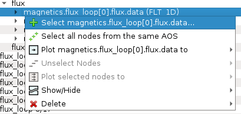
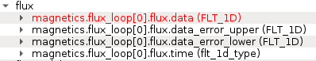
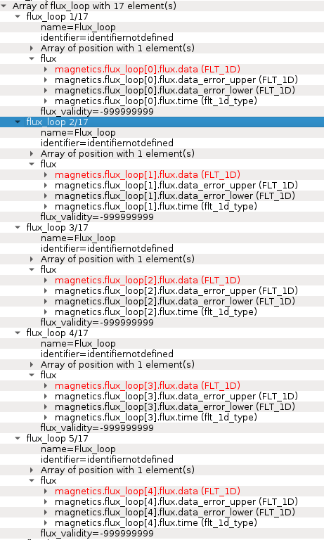
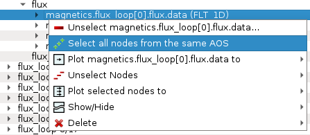
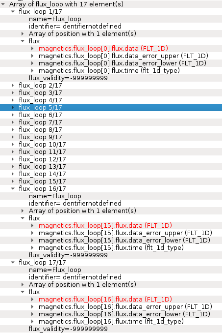
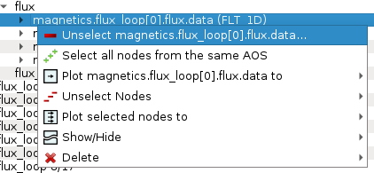
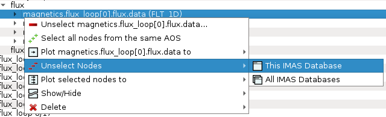

..
   Copyright holders : Commissariat à l’Energie Atomique et aux Energies Alternatives (CEA), France;
   and Laboratory for Engineering Design - LECAD, University of Ljubljana, Slovenia
   CEA and LECAD authorize the use of the METIS software under the CeCILL-C open source license https://cecill.info/licences/Licence_CeCILL-C_V1-en.html
   The terms and conditions of the CeCILL-C license are deemed to be accepted upon downloading the software and/or exercising any of the rights granted under the CeCILL-C license.

.. include:: ../icons.inc

.. _signal_node_selection:

Node selection features
=======================

:guilabel:`IMASViz` offers the user the ability to set or mark a
selection of plottable arrays (nodes) as once. This way plotting multiple
plots to the same :guilabel:`Figure` or to a :guilabel:`MultiPlot View`
is more convenient and faster, avoiding "one-by-one" plotting.

.. Note::
   How to plot selection is described later in section
   :ref:`plotting_1d_arrays`.

In the continuation of this section different methods of node selection are
described.

Select One-by-one
-----------------

To select nodes one by one, first, right-click on the wanted node.
From the shown pop-up menu, select the command
:guilabel:`Select <node name>` |icon_plus|.

   Selecting a plottable node.

The selected node label gets colored red, indicating that it is added
to the selection.

   Node colored red -> node is selected.

Repeat that procedure until all wanted nodes are selected.

   Example of multiple nodes selection.

.. Note::
   At the same time, nodes from other opened IDS databases too can be
   selected.

.. Note::
   A node coloured red is a node the plotting commands will draw, and a node
   coloured blue is a node they will not: the colour and the selection are one
   and the same record, so the tree cannot show a selection different from the
   one the next plot uses. Selecting a node that is already selected leaves the
   selection as it was; unselecting a node that is not selected does nothing.
   The order in which the nodes were picked is kept, and re-selecting a node does
   not move it.

Select All Nodes of the same Structure (AOS)
--------------------------------------------

To select all nodes of the same structure (same node structure type),
right-click on one of the nodes and from the shown popup-menu select the option
:guilabel:`Select All Nodes From The Same AOS` |icon_plus3x|.

   Selecting plottable nodes of the same structure/type.

All nodes of the same structure will be selected and their label will be
colored to red, indicating that they were added to the selection.

   Node colored red -> node is selected. All plottable nodes of the
   same structure/type are selected, in this case, 17 nodes.

.. Note::
   The structure is the array of structures the node under the mouse belongs to,
   and the selection covers every element of that array -- in the example above,
   the 17 probes of one flux loop array. It stays inside the occurrence of the
   IDS that node was reached through: if the same IDS is loaded at several
   occurrences in the same view, the nodes of the other occurrences are not
   selected, and are not selected by a node right-clicked in one of them either.
   A quantity held by several nested arrays of structures is selected across all
   of their elements, since the structure it sits in is the same one.

Save Node Selection Configuration
---------------------------------

Any node selection can be saved to a configuration file and used later with any
opened IMAS database. To save a selection, follow the next steps:

1. In the main tree browser menu navigate to **Node Selection** ->
   **Save Node Selection**.

2. In opened GUI window type the name of the configuration.

   .. figure:: images/SavePlotSelection_dialog.png
      :align: center
      :scale: 75%

      Save Node Selection Dialog.

3. Press **OK** button.

.. Note::
   The configurations are saved to ``$HOME/.imasviz`` folder.

.. Note::
   A node selection configuration holds the quantities it names, in the order
   they were selected, with the occurrence of the IDS each was reached through.
   Nothing about how the tree looked is saved.

.. Note::
   Saving an empty selection says so in the log panel of the shot view instead of
   writing a configuration that names nothing.

.. _apply_selection_from_configuration:

Apply Selection From Saved Configuration
----------------------------------------

Applying saved node selection can be performed using both
:guilabel:`Node Selection Configuration` and
:guilabel:`MultiPlot Configuration`.

Apply Selection From Saved Node Selection Configuration
~~~~~~~~~~~~~~~~~~~~~~~~~~~~~~~~~~~~~~~~~~~~~~~~~~~~~~~

To apply selection from :guilabel:`Node Selection Configuration`, follow the
next steps:

1. In the main tree browser menu navigate to **Actions** ->
   **Apply Configuration**. In the shown window switch to
   :guilabel:`Available Node Selection Configurations` tab.

   .. figure:: images/ApplyPlotConfiguration_NodeSelection.png
     :align: center
     :scale: 75%

     :guilabel:`Apply Node Selection Configuration` tab.

2. Select the configuration from the list.

3. Press **Apply selection only**.

   The signal nodes, found in the configuration file, will then be selected.
   The selection this leaves is the same as the one the tree mouse makes: the
   nodes are coloured as selected and a plot entry started from here draws them.

.. Note::
   Applying a configuration names the IDS each quantity belongs to, and an IDS
   whose data are not in the tree yet is loaded first. A quantity this database
   does not hold is named in the log panel of the shot view and skipped; the rest
   of the configuration is selected.

.. Note::
   Applying a configuration replaces the selection that was there. The list in
   the window is read from :file:`$HOME/.imasviz` every time the window is shown,
   so a configuration saved from a :guilabel:`Table Plot View`, from another shot
   view, or with the user's own editor, is there without restarting anything.

Apply Selection From MultiPlot Configuration
~~~~~~~~~~~~~~~~~~~~~~~~~~~~~~~~~~~~~~~~~~~~

To apply selection from :guilabel:`MultiPlot Configuration`, follow the
next steps:

.. seealso::
   How the create MultiPlot Configuration is described in
   :ref:`TPV`.

1. In Main Tree View Window menu navigate to **Actions** ->
   **Apply Configuration**. In the shown window switch to
   :guilabel:`Apply Plot Configuration` tab.

   .. figure:: images/ApplyPlotConfiguration_window.png
     :align: center
     :scale: 75%

     :guilabel:`Apply Plot Configuration` tab.

2. Select the configuration from the list.

3. Press **Apply selection only**.

   The signal nodes, found in the configuration file, will then be selected.

Unselect selected Node Signals
------------------------------

There are few features that allow node signal unselection.

Unselect One-by-one
~~~~~~~~~~~~~~~~~~~

To unselect nodes one by one, first, right-click on the selected node.
From the shown pop-up menu, select the command
:guilabel:`Unselect <node name>` |icon_minus|.

   Unselecting plottable node.

Unselect All
~~~~~~~~~~~~

To unselect all selected nodes, first, right-click on the selected node.
From the shown pop-up menu, select the command
:guilabel:`Unselect Nodes` |icon_minus3x| ->
:guilabel:`This IMAS Database` |icon_thisDTV| or
:guilabel:`All IMAS Databases` |icon_allDTV|.

   Unselecting multiple plottable nodes at once.

.. Note::
   :guilabel:`This IMAS Database` clears the selection of the view the command
   was asked from; :guilabel:`All IMAS Databases` clears the selection of every
   opened view. Either clears the whole selection, including a node whose IDS was
   closed and loaded again since it was selected: what is cleared is the
   selection, and the label of every node it held goes back to its unselected
   colour.

